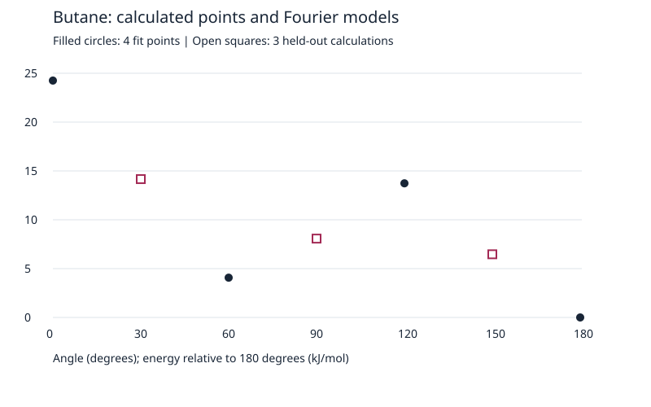
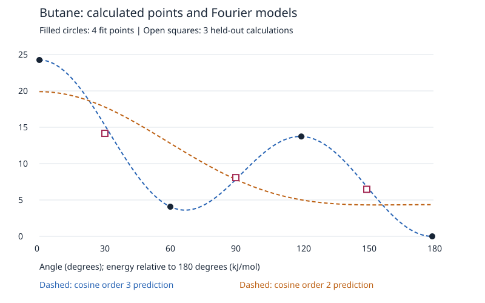
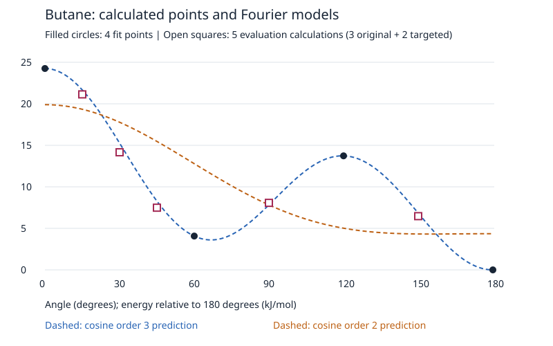

# Butane torsional energies → conformer populations

A computational chemistry coursework extension: audit original Gaussian calculations, distinguish constrained torsions from conformer minima, and quantify how state counting and thermodynamic approximations change populations.

**Status (2026-10-15):** four historical calculations recovered; three new minimum optimizations with frequencies and nine new constrained optimizations completed. A preregistered Fourier model was evaluated against three separately calculated held-out angles, then two targeted follow-up angles without refitting. This is an educational calculation study, with AI-assisted implementation and analysis; it does not establish experimental conformer populations or a new electronic-structure method.

## Reproduce the analysis

Python 3.12, standard library only. No installation or Gaussian license is needed to analyze the published extracted data.

```sh
python analyze.py
python analyze_followup.py
```

The command regenerates CSV results, model coefficients and two standalone SVG figures in `results/`. It was actually executed with Python 3.12. Gaussian inputs are in `inputs/`; rerunning those electronic-structure calculations requires your own licensed Gaussian 16 installation and suitable compute allocation. Each input requests four processors and 4 GB; checkpoints have unique relative filenames. No scheduler or server configuration is supplied.

## Calculations and provenance

| Dataset | Calculations | Purpose |
|---|---:|---|
| Historical coursework | 0°, 60°, 120°, 180° | Recover the report's energies from original logs |
| New minima | anti, gauche+, gauche− | Unconstrained Opt/Freq at 298 K, 1 atm |
| New torsions, fit set | 0°, 60°, 120°, 180° | Determine the preregistered cosine models |
| New torsions, held-out set | 30°, 90°, 150° | Independent electronic-structure values for model evaluation |

All use neutral singlet butane and B3LYP/6-31+G(d), with Cartesian 6D polarization functions. The original route uses `Opt=ModRedundant`; new jobs use `Opt=Tight`, `SCF=Tight`, `Int=UltraFine`, `NoSymm`, and explicit `6D`. Constrained jobs use `Opt=(Tight,ModRedundant)` with `D 1 5 8 11 F`, optimizing the remaining 35 internal degrees of freedom. The four atom indices are carbon atoms in chain order. New calculations used Gaussian 16 C.01.

Every new calculation terminated normally and met all four final optimization convergence criteria. Each minimum has 36 positive vibrational frequencies. The seven constrained angles agree with their targets within 0.0002°; their inferred bond graphs retain C4H10 connectivity. Constrained jobs have no frequency or thermal correction results. Their electronic energies are never mixed with the minimum Gibbs energies.

`data/` contains extracted audit tables, source-log SHA-256 hashes, extraction line numbers, input provenance, and final constrained geometries. Full original logs are retained privately. [PROVENANCE.md](PROVENANCE.md) explains what is and is not reproduced by the public data.

## What the original report gets right—and what changes

The recovered original 60°–180° electronic-energy difference is **4.073121 kJ/mol**, reproducing the reported **4.07**. The actual basis is **6-31+G(d)**, not the `(d,p)` notation in part of the report. The optimization keyword is **ModRedundant**, not `moderate`.

The reported approximately 84%/16% can be reproduced by normalizing the four sampled angles with one weight each, using the original energies, 298 K and R=8.31 J mol⁻¹ K⁻¹. The original formula file remains unavailable, so this is a reproducing calculation rather than proof of the exact historical formula. Barrier-region points are not independent stable conformers, and a single +60° structure does not count both gauche wells.

The new matched settings give **4.073565 kJ/mol** at fixed 60°, whereas the unconstrained gauche minima are at **±65.315555°** with a gap of **3.830641 kJ/mol**. Using absolute electronic energies, relaxation of the fixed 60° structure lowers its energy by about **0.243 kJ/mol**. The control calculations show that the original reported gap was already numerically consistent; the distinction between a fixed angle and a minimum matters more here.

## Independent Fourier evaluation

The primary model was fixed before the new calculations:

`V(phi) = a0 + a1 cos(phi) + a2 cos(2 phi) + a3 cos(3 phi)`.

Only 0°, 60°, 120°, 180° determine its four coefficients. Its exact interpolation of those four points is not validation. The secondary model uses cosine orders 1–2 with least squares on the same four fit points. Neither model was retuned using the held-out energies.

| Model | Held-out MAE | Held-out RMSE | Maximum absolute error |
|---|---:|---:|---:|
| Cosine orders 1–3 | 0.5714 | 0.6849 | 1.1004 |
| Cosine orders 1–2 | 2.0016 | 2.4315 | 3.6159 |

All errors are kJ/mol, over **three** independently calculated angles. The primary prediction errors at 30°/90°/150° are +1.1004/−0.2436/+0.3704. This small validation set does not establish whole-curve accuracy. The secondary model lacks the correct three-well topology; no anti/gauche basin population is assigned to it.





## Population models at 298 K

For grouped equivalent states, `p_i = g_i exp(-Delta E_i/RT) / sum_j[g_j exp(-Delta E_j/RT)]`. If gauche+ and gauche− appear separately, each has `g=1`; do not multiply either by two again.

| Approximation | Combined gauche population |
|---|---:|
| Reported 4.07 gap, only one gauche included | 16.21% (one state, incomplete two-well counting) |
| Reported 4.07 gap, two equivalent gauche included | 27.90% |
| New minimum electronic energies, two gauche | 29.88% |
| New minimum RRHO Gibbs energies, two gauche | 27.29% |
| Primary Fourier curve, uniform-angle basin integration | 31.26% |

These percentages answer different approximate questions. Discrete electronic weights assume equal internal partition contributions per well. One-dimensional integration includes model well widths in the torsion coordinate, but assumes uniform `dphi` measure and omits angle-dependent contributions from other coordinates. RRHO Gibbs energies include ideal-gas translational, rotational and harmonic vibrational contributions about minima, but treat internal torsion harmonically. The one-dimensional integral is not multiplied by another gauche degeneracy factor, and is not combined with a harmonic torsion contribution.

The primary model places its interior minimum at 66.79° and basin boundary at 119.52°. The already-known minimum at 65.32° is a diagnostic, not a blind validation point. Integrating each half-domain basin with 1,000 versus 10,000 midpoint cells gives the same 31.26216% to displayed precision. This establishes numerical quadrature stability only, not physical or electronic-structure accuracy.

All three Gaussian minimum outputs report rotational symmetry number 1. Both physical conformers have symmetry number 2; applying that same correction to every minimum adds the same RT ln 2 to each Gibbs energy and leaves relative populations unchanged. Rotational symmetry and the two gauche wells are different counts. See [NIST butane](https://webbook.nist.gov/cgi/cbook.cgi?ID=C106978&Mask=1809) and [Gaussian thermochemistry](https://gaussian.com/wp-content/uploads/dl/thermo.pdf).

## Completed targeted follow-up: 15° and 45°

After inspecting the original 30° error, two new angles were selected for a local check. Both calculations converged and terminated normally, retained the expected bond graph, and matched their target angles within 0.00024°. All conditions match the original seven-point set; its 180° energy remains the reference. The models from commit `3090f6b` were frozen before these jobs and are preserved in `data/frozen_models_3090f6b.json`.

| Angle | Calculated relative E | Frozen order-3 prediction | Prediction minus calculation |
|---|---:|---:|---:|
| 15° | 21.134655 | 21.671055 | +0.536400 |
| 45° | 7.488650 | 8.281992 | +0.793343 |

Energies are kJ/mol. The two-point order-3 MAE/RMSE are 0.664871/0.677170 kJ/mol; order-2 values are 4.887430/5.784826. The order-3 model overestimates both new points as well as the original 30° point. This indicates a local shape discrepancy in the 15–45° region. The new angles were selected adaptively, so these metrics are reported separately and do not replace the original three-point evaluation. No coefficients or population estimates were revised.

`python analyze_followup.py` reproduces these results and the nine-point plot. The original figures above retain only the original seven-point dataset.



## Next step

Keep the seven-point evaluation and targeted two-point follow-up frozen. A next study could compare a richer symmetry-preserving Fourier model using an explicitly revised fit set and new untouched validation angles. Do not report the already-inspected five evaluation points as a fresh independent test after fitting them. Denser constrained calculations, alternative starting structures, hindered-rotor treatment, basis/method sensitivity, and experiment would address different remaining uncertainties. No such expanded study or ML training has been performed.

The original plan is preserved in [docs/preregistered_plan_ko.md](docs/preregistered_plan_ko.md), including its historical “not yet executed” status. This README and the result CSVs record the completed execution.
